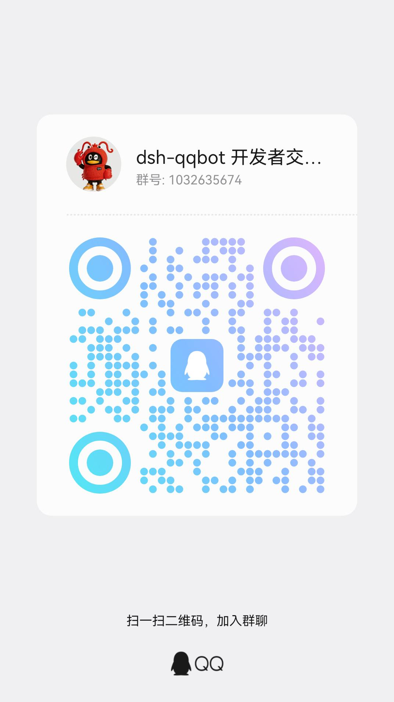
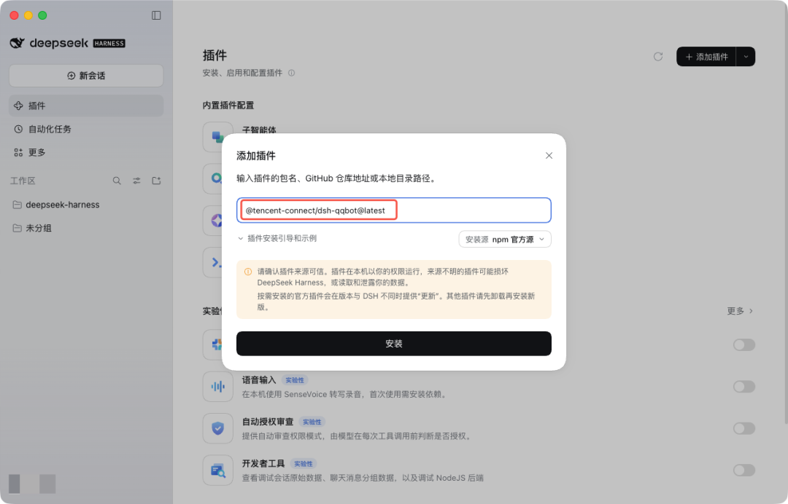
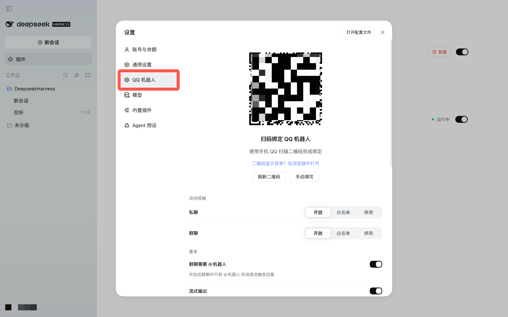
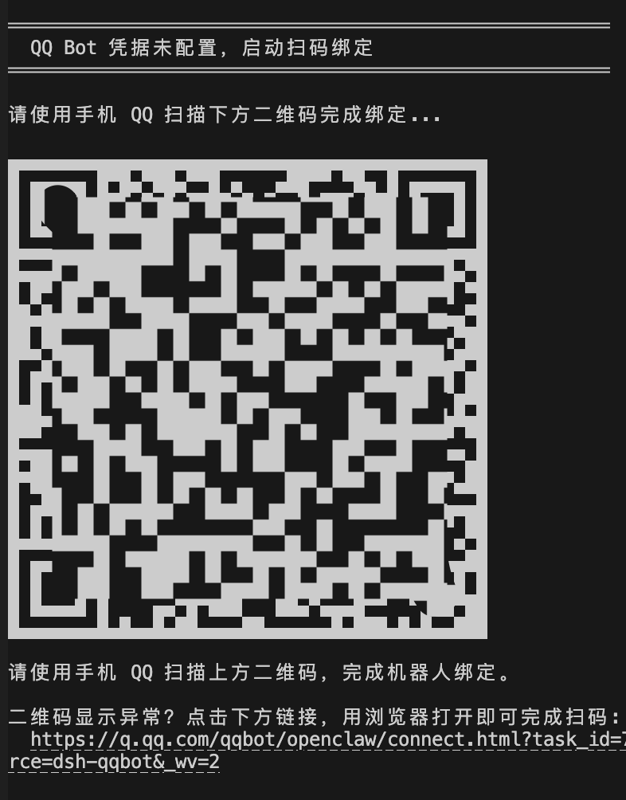

> ## ⚠️ 这是一个维护分支（modified fork），不是腾讯官方发布包
>
> 本包 `dsh-qqbot-merge` 是 **[@tencent-connect/dsh-qqbot](https://github.com/tencent-connect/dsh-qqbot) 0.5.3（MIT）** 的维护分支，
> 在原版基础上新增 **「连续消息智能合并」（非打断式 steering）** 与 **「同一轮只发一条回复并持续修订」**，
> 并对外提供 `qqbotMerge` cordis 服务，供 [dsh-longterm-memory](https://github.com/bufan528/dsh-longterm-memory)
> 的「QQ 接入」页读取/写入配置。
>
> - 原项目版权归 Tencent Connect 所有，见 [LICENSE](./LICENSE)；本分支的修改部分同样以 MIT 发布。
> - **不能与官方 `@tencent-connect/dsh-qqbot` 同时启用**：两者都会用同一个 QQ Bot `appId` 建立网关连接、
>   注册绑定页路由。启用本包 = **替换**官方 QQ 插件（详见下方「安装与迁移」）。
> - 安全提示：官方原版会把 `appId` / `appSecret` 以明文写入 profile 的 `cordis.patch.yml`；本分支沿用同一机制，
>   不额外保存、不上传、不回显 Secret。
>
> ### 安装与迁移（替换官方 QQ 插件）
>
> ```powershell
> # 1) 安装本分支
> npx @deepseek-ai/dsh plugin --profile desktop add dsh-qqbot-merge
>
> # 2) 从 profile 移除官方插件，并把 bundles 里的 "@tencent-connect/dsh-qqbot" 换成 "dsh-qqbot-merge"
> npx @deepseek-ai/dsh plugin --profile desktop remove @tencent-connect/dsh-qqbot
>
> # 3) 迁移凭据：把原 `im-qqbot` 行的 appId/appSecret 复制到新行（行 id 为 `qqbot-merge`），
> #    或重启后重新扫码绑定；不要在两行里同时保留凭据
>
> # 4) 重启 DSH 桌面端
> ```
>
> 启用合并（可选，默认关闭、行为与官方 0.5.3 一致）：在 DSH 的 **长期记忆 → QQ 接入 → 连续消息智能合并**
> 打开开关并保存；或直接改 profile `cordis.patch.yml` 里 `qqbot-merge` 行的
> `qqbotMerge.enabled: true`。
>
> ### 与官方 0.5.3 的差异
>
> | 方面 | 官方 0.5.3 | 本分支 |
> |---|---|---|
> | 任务执行中收到新消息 | `concurrencyGuard(strategy:'merge')` 缓冲到本轮结束后再合并 → 下一轮处理 | 合并窗口（默认 800ms）后通过公开 `agent.steer()` 并入**当前轮下一步骤**，不取消当前模型调用/工具 |
> | 一轮多 step 的输出 | 每个 `assistant/message` 各发一条 QQ 消息 | 同一轮只在同一条 QQ 消息上全量重写，`turn/end` 只 `complete` 一次（群聊/非流式降级为轮末单条） |
> | 对外接口 | 无 cordis 服务 | `ctx.provide('qqbotMerge', …)`，契约 `qqbot-merge@v1` |
> | 其余功能 | —— | 审批、待答问题、文件交付、群聊历史、模型/预设切换、绑定页均保留 |
>
> 真实 QQ 端到端（连续消息 → 一条回复）尚未在发布者机器上验证（未替用户替换运行中的实例；同一 `appId`
> 无法并行建两条连接）。使用前请先测试，并保留回滚：把 profile 的 `dependencies`/`bundles` 换回
> `@tencent-connect/dsh-qqbot@0.5.3` 即可。

<div align="center">


**基于 [deepseek-harness](https://github.com/deepseek-ai/deepseek-harness) (dsh) 的 QQ Bot 插件，将 DeepSeek AI 助手接入 QQ 私聊与群聊。**

[](https://www.npmjs.com/package/@tencent-connect/dsh-qqbot)
[](./LICENSE)
[](https://github.com/tencent-connect/dsh-qqbot)
[](https://bot.q.qq.com/wiki/)

<br/>

**[English](./README_EN.md) | 简体中文**

扫码加入 QQ 群 / 频道

<table>
<tr>
<td align="center" width="50%"><br /><b>QQ 开发者交流群</b><br /><sub>群号: 1032635674</sub></td>
<td align="center" width="50%"><br /><b>QQ 开发者社区频道</b><br /><sub>频道号: 20dnumts4z</sub></td>
</tr>
</table>

</div>

> **这是维护分支 `dsh-qqbot-merge@0.1.0`**，fork 自官方
> [`@tencent-connect/dsh-qqbot`](https://github.com/tencent-connect/dsh-qqbot) **0.5.3**（MIT，源码取自
> `codeload.github.com/tencent-connect/dsh-qqbot/zip/refs/tags/0.5.3`）。在上游功能之上新增：
>
> - **连续消息智能合并**：Agent 执行任务期间用户连续发来的消息，按 QQ 会话隔离、以静默窗口
>   （默认 800ms）合并；忙碌时用 `agent.steer(...)` 非打断式并入当前轮的下一个 step，
>   空闲时用 `agent.followup(...)`，不再排队到下一轮；`agent/turn-stopping` 时把仍在窗口内的
>   批次并入当前轮；steer 竞态自动降级 followup；超上限的消息通知用户并作为下一批 followup
>   （不静默丢弃）。
> - **同一轮单条回复**：`replyMode: 'single-message'` 时，一轮里多个 step 的文本持续修订
>   同一条 QQ 消息（turn/end 才 complete），流式不可用时降级为轮末单条静态发送。
> - **对外 cordis 服务 `qqbotMerge`**（契约 `qqbot-merge@v1`）：供 DSH Memory Vault 等插件读取
>   真实配置/计数/最近批次并写入配置；配置只写本插件自己的 cordis row config。
>
> 合并默认 **关闭**（`qqbotMerge.enabled: false`），关闭时行为与官方 0.5.3 完全一致。
> 本包与官方插件**不能同时启用**（同一个 QQ appId、同名绑定页路由）。
> 真实 QQ 端到端未验证；详见仓库的 `docs/evidence/qqbot-merge-implementation.md`。

## 架构

```
QQ 用户 → QQ WebSocket → dsh-qqbot → ctx.agents → dsh agent loop → LLM
                                 ↑                           │
                                 └── session/event ──────────┘
                                       (assistant reply → QQ sendMarkdown)
```

## 安装

### 方式一：桌面版安装（推荐）

无需命令行，全程在应用内完成：

1. **安装**：左侧栏点击「插件」→「添加插件」→ 输入 `@tencent-connect/dsh-qqbot@latest` → 安装并立即启动



2. **连接**：左下角头像 → 设置 →「QQ 机器人」→ 手机 QQ 扫码连接



扫码成功后凭据自动保存，后续启动无需再次扫码。

### 方式二：手动执行

```bash
# 安装到 profile
npx @deepseek-ai/dsh plugin --profile qqbot add @tencent-connect/dsh-qqbot

# 启动
npx @deepseek-ai/dsh --profile qqbot
```

首次启动时，插件检测到凭据未配置会自动进入扫码引导：终端输出二维码 → 手机 QQ 扫码绑定 → 凭据自动保存到 profile，后续启动无需再次扫码。

无端内绑定页的环境（如纯 CLI）可设置 `QQBOT_BIND_OPEN_BROWSER=1`，额外拉起系统浏览器扫码页作为降级通道。



> **提示**：建议升级至 `0.4.0` 以上版本扫码，支持点击链接在浏览器打开，避免部分终端二维码渲染错位的问题。

### 方式三：本地路径安装

```bash
# 构建
cd /path/to/dsh-qqbot
pnpm install && pnpm build

# 安装到 profile（本地路径）
npx @deepseek-ai/dsh plugin --profile qqbot add /path/to/dsh-qqbot

# 启动
export QQBOT_APPID="你的AppID" QQBOT_SECRET="你的AppSecret"
npx @deepseek-ai/dsh --profile qqbot
```

### 方式四：--patch 开发模式

```bash
export QQBOT_APPID="你的AppID" QQBOT_SECRET="你的AppSecret"
npx @deepseek-ai/dsh web --patch /path/to/dsh-qqbot/cordis.dev.yml
```

## 配置项

| 配置 | 类型 | 默认值 | 说明 |
|------|------|--------|------|
| `appId` | string | **必填** | QQ Bot AppID（或通过 `QQBOT_APPID` 环境变量） |
| `appSecret` | string | **必填** | QQ Bot AppSecret（或通过 `QQBOT_SECRET` 环境变量） |
| `provider` | string | `deepseek-official` | LLM 提供商名称 |
| `model` | string | `deepseek-chat` | 模型名称 |
| `preset` | string | - | Agent preset id |
| `cwd` | string | `process.cwd()` | Agent 工作目录 |
| `requireMention` | boolean | `true` | 群聊是否需要 @bot 才触发 |
| `groupPrompt` | string | - | 群聊额外 system prompt |
| `directPrompt` | string | - | 私聊额外 system prompt |
| `textChunkLimit` | number | `4500` | 单条消息最大字符数 |
| `streaming` | boolean | `true` | 是否启用流式输出（群聊始终不启用） |
| `sessionIdleTimeout` | number | `1800000` | 会话闲置超时(ms)，默认 30 分钟 |
| `processingTimeoutMs` | number | `1800000` | 处理超时(ms)，超时中断当前 LLM 调用 |
| `maxQueue` | number | `20` | 并发队列最大长度 |
| `historyLimit` | number | `10` | 群历史缓冲条数 |
| `askTimeoutMs` | number | `300000` | 待答问题超时(ms)，默认 5 分钟（ask_user_question） |
| `showToolResults` | boolean | `false` | 是否展示工具调用成功结果（错误始终展示） |
| `debug` | boolean | `false` | 调试模式 |

### 访问控制（access）

| 配置 | 类型 | 默认值 | 说明 |
|------|------|--------|------|
| `access.c2cMode` | `open`/`allowlist`/`disabled` | `open` | 私聊访问模式 |
| `access.c2cAllow` | string[] | `[]` | 私聊白名单（user openid） |
| `access.groupMode` | `open`/`allowlist`/`disabled` | `open` | 群聊访问模式 |
| `access.groupAllow` | string[] | `[]` | 群聊白名单（group openid） |

### 富媒体理解（media）

| 配置 | 类型 | 默认值 | 说明 |
|------|------|--------|------|
| `media.enabled` | boolean | `true` | 是否启用富媒体理解（图片/视频下载 + 工具分析） |
| `media.maxMB` | number | `200` | 富媒体下载大小上限(MB) |
| `media.ttlHours` | number | `24` | 富媒体存活时长(小时)，0=永不过期 |

### 视觉理解（vision）

| 配置 | 类型 | 默认值 | 说明 |
|------|------|--------|------|
| `vision.enabled` | boolean | `false` | 是否启用视觉理解（qqbot_describe_image 工具） |
| `vision.provider` | string | - | 视觉模型 provider（如 pi-ai） |
| `vision.model` | string | - | 视觉模型 id（如 qwen-vl-max） |
| `vision.maxBytes` | number | `10MB` | 图片字节上限 |
| `vision.maxTokens` | number | `1024` | 输出 token 上限 |
| `vision.timeoutMs` | number | `120000` | 视觉调用超时(ms) |

### 附件发送（sendFile）

| 配置 | 类型 | 默认值 | 说明 |
|------|------|--------|------|
| `sendFile.restrictPaths` | boolean | `true` | 是否启用路径白名单（仅 media + cwd + extraRoots） |
| `sendFile.extraRoots` | string[] | `[]` | 额外允许访问的根目录 |

## 内置命令

| 命令 | 说明 |
|------|------|
| `/new`（别名 `/reset` `/clear`） | 开始新会话（清空上下文） |
| `/compact` | 压缩会话历史（摘要替换旧记录，保留上下文） |
| `/model` | 查看或切换模型 |
| `/preset` | 查看或切换 agent preset（新会话生效） |
| `/stop` | 中止当前生成 |
| `/bot-ping` | 网络延迟检测（返回传输与处理耗时） |
| `/bot-version` | 查看版本信息 |
| `/bot-status` | 查看当前会话状态 |
| `/bot-help` | 查看所有指令 |

## 核心模块

```
src/
├── index.ts                    # Cordis 插件入口（async apply）
├── config.ts                   # 配置 Schema
├── types.ts                    # 全局类型定义
├── setup/                      # 凭据绑定（扫码）
│   ├── index.ts                # 绑定编排（ensureCredentials）
│   ├── binding-service.ts      # 扫码状态机（宿主内唯一事实源）
│   ├── bind-routes.ts          # 端内绑定页路由（/qqbot/im-qqbot/bind）
│   ├── presenters.ts           # 呈现策略（终端/浏览器降级）
│   ├── qr-svg.ts               # 二维码 SVG 渲染（宿主侧）
│   └── persist.ts              # 凭据写入 cordis.patch.yml
├── client/                     # 浏览器半边（dsh.client Web Bundle）
│   ├── index.ts                # 侧栏 Tab 注册 + 待绑定自动引导
│   └── bind-page.ts             # 端内绑定页（二维码 + 状态轮询）
├── gateway/                    # 网关装配
│   ├── bootstrap.ts            # 启动装配（监听 session/event 等）
│   └── middleware-setup.ts     # 中间件链配置
├── transport/                  # 传输层
│   ├── inbound.ts              # QQ 入站消息 → agent.followup()
│   ├── outbound.ts             # session/event → QQ sendMarkdown
│   ├── outbound-buffer.ts      # 流式缓冲
│   ├── streaming-writer.ts     # 流式写入
│   ├── reply-target.ts         # 回复目标解析
│   ├── msgid-cache.ts          # 被动回复 msgid 缓存
│   ├── reply-limiter.ts        # 被动回复限流
│   ├── tool-presenter.ts       # 工具调用展示
│   └── chunker.ts              # Markdown 文本切分
├── session/                    # 会话管理层
│   ├── session-manager.ts      # QQ peer → Agent 映射
│   └── idle-evictor.ts         # 闲置回收
├── model/                      # 模型路由层
│   ├── model-resolver.ts       # 路由解析
│   ├── prefs-store.ts          # per-peer 偏好持久化
│   └── settings-reader.ts      # settings.yaml 只读
├── features/                   # 交互特性
│   ├── question-channel.ts     # ask_user_question 问答通道
│   ├── approval-channel.ts     # approval 审批确认通道
│   └── answer-parser.ts        # 答案解析
├── media/                      # 多媒体
│   ├── vision-tool.ts          # 图片视觉理解
│   ├── send-file-tool.ts       # 发送本地文件
│   └── media-cleaner.ts        # 媒体 TTL 清理
├── middleware/                 # 中间件
│   ├── question-answer.ts      # 问答答案处理
│   └── attachment.ts           # 附件处理
├── shared/                     # 共享工具
│   ├── utils.ts                # 通用函数
│   ├── scope.ts                # scope/peer 提取
│   └── send-helper.ts          # 分块发送
└── commands/                   # 斜杠命令
```

## 会话路由

sessionKey: `qqbot:${appId}:${scope}:${peerId}`，由 SHA-256 确定性派生 SessionId，重启后可恢复。

解析策略：进程内复用 → 持久化恢复 → 全新创建。

## 设计原则

- **纯 Cordis 插件** — 遵循 dsh "Plugins, not loop changes" 原则
- **声明式依赖** — `inject = ['agents']`，不直接耦合其他插件
- **会话隔离** — 每个 QQ 私聊用户/群聊各一个独立 Agent
- **Preset 支持** — 可通过 `agent-presets` 服务挂载预设（工具集、prompt 等）
- **闲置回收** — 超时自动 dispose Agent，防止内存泄漏
- **Markdown 输出** — 回复以 Markdown 格式发送，支持代码块/表格感知切分
- **图片理解** — 支持 `qqbot_describe_image` 视觉理解，可分析用户发送的图片
- **附件发送** — 支持 `qqbot_send_file` 将本地文件发送给用户（默认启用路径白名单）
- **问答互动** — 支持 `ask_user_question`，单选生成内联按钮（点一个其余变灰）、多选回复编号，逐题推进 + 问题级超时
- **操作确认** — 支持 `approval/request`，关键操作通过「允许/拒绝」按钮请求用户确认

## 本地开发

```bash
# 安装依赖
pnpm install

# 构建
pnpm build

# 开发模式（watch）
pnpm dev

# 用 --patch 方式调试
export QQBOT_APPID="xxx" QQBOT_SECRET="xxx"
npx @deepseek-ai/dsh web --patch /path/to/dsh-qqbot/cordis.dev.yml
```

## License

[MIT](./LICENSE)
